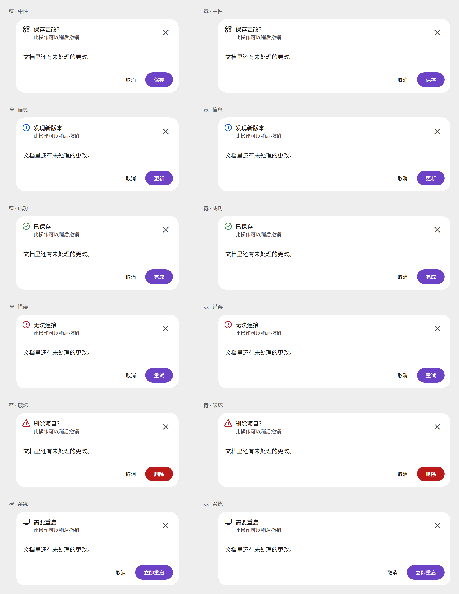
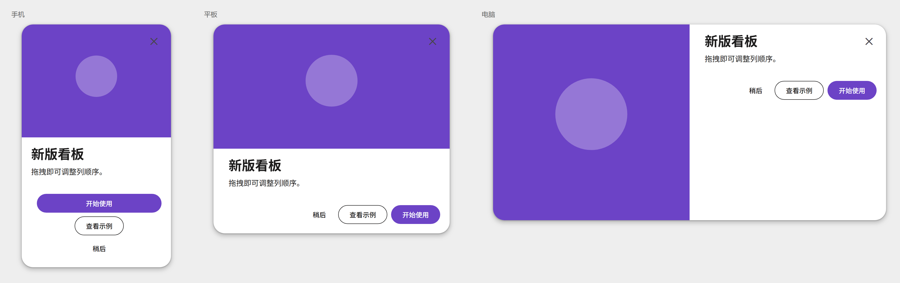
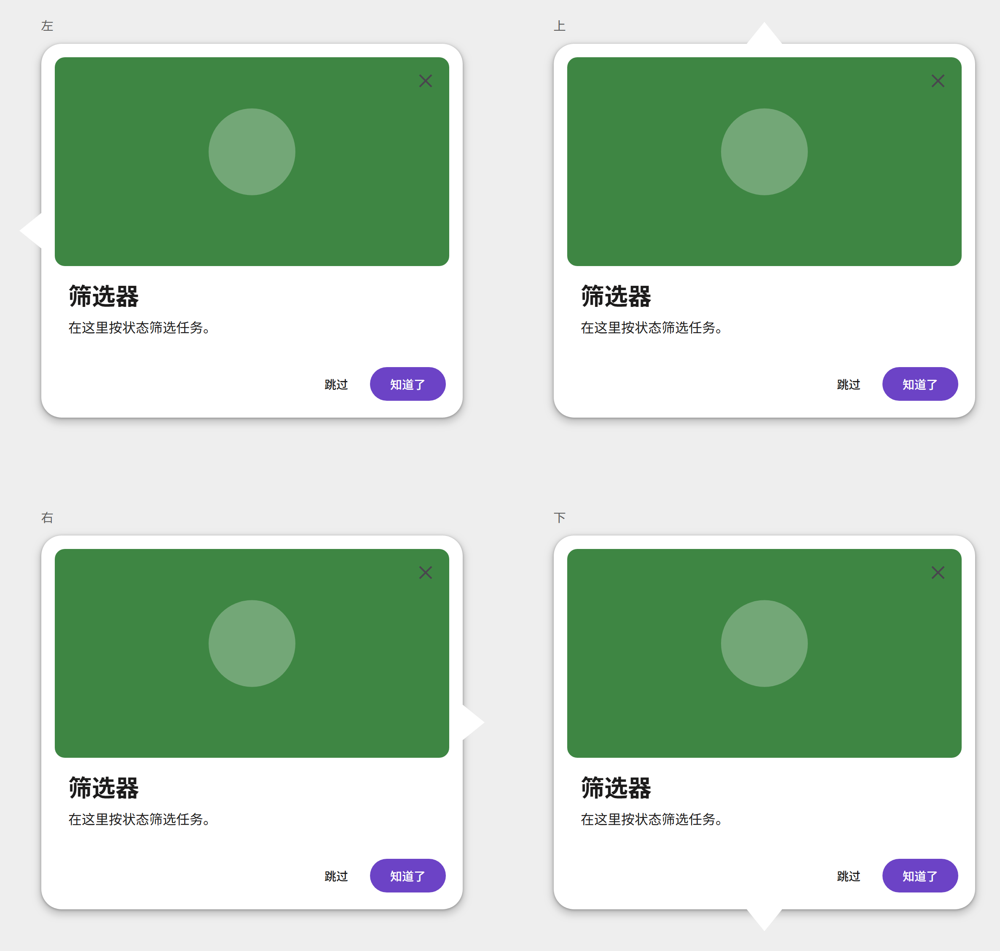
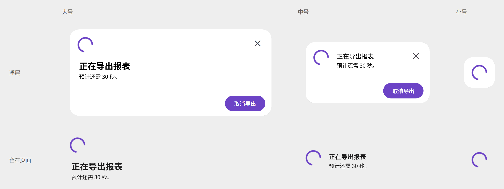

# 弹窗

弹窗在页面上方显示需要确认、引导或等待的内容。

## 引入

按用途引入。一个页面可以只用其中一类。

| 标签 | 何时使用 |
| --- | --- |
| `<md-modal>` | 需要确认的内容。有遮罩，点遮罩或按 Esc 会取消 |
| `<md-hero-modal>` | 带主图的说明。有遮罩 |
| `<md-feature-tour-modal>` | 贴在页面旁边分步说明。没有遮罩 |
| `<md-loading-modal>` | 处理过程中的等待。遮罩和 Esc 都不关 |

```js
import 'genv4/modal/modal.js';
import 'genv4/hero-modal/hero-modal.js';
import 'genv4/feature-tour-modal/feature-tour-modal.js';
import 'genv4/loading-modal/loading-modal.js';
```

## 示例

每类一张图，把这一类的主要样子放在一起。下面各一份代码，写上可用属性。`returnValue` 没有 HTML 属性。默认就是开的布尔属性写在标签上只是标出它；要关掉只能在脚本里设为 false。

<style>
  .figure-wrapper figure {
    box-sizing: border-box;
    margin-inline: 0;
    max-width: 100%;
    min-width: 0;
    width: 100%;
  }

  .figure-wrapper img {
    display: block;
    height: auto;
    width: 100%;
  }
</style>

### 对话弹窗

左边一列是窄版，右边一列是宽版。每列从中性、信息、成功、错误、破坏到系统。

<div class="figure-wrapper">
  <figure>
    
  </figure>
</div>

```html
<md-modal open variant="destructive" size="wide" layout="horizontal"
    content-margin leading-item icon="delete" close title="删除项目？"
    show-subtitle subtitle="此操作无法撤销"
    show-cancel show-secondary-action show-tertiary-action tertiary="checkbox">
  <p>「GenV4 文档」及其 12 个文件会被永久删除。</p>
  <span slot="tertiary">不再提示</span>
  <span slot="cancel">取消</span>
  <span slot="secondary">移到回收站</span>
  <span slot="primary">删除</span>
</md-modal>
```

### 主视觉弹窗

从左到右是手机、平板、电脑三种宽度。`type="walkthrough"` 时底栏换成上一页和下一页。

<div class="figure-wrapper">
  <figure>
    
  </figure>
</div>

```html
<md-hero-modal open size="tablet" type="default" content-margin scroll-bar close
    show-cancel show-secondary-action show-tertiary-action tertiary="button">
  
  <section><h2>新版看板</h2><p>拖拽即可调整列顺序。</p></section>
  <span slot="tertiary">了解更多</span>
  <span slot="cancel">稍后</span>
  <span slot="secondary">查看示例</span>
  <span slot="primary">开始使用</span>
</md-hero-modal>
```

### 功能引导

没有遮罩。箭头分别在左、上、右、下。

<div class="figure-wrapper">
  <figure>
    
  </figure>
</div>

```html
<md-feature-tour-modal open caret="left" caret-position="start" type="default"
    content-margin scroll-bar close
    show-cancel show-secondary-action show-tertiary-action tertiary="checkbox">
  
  <section><h2>筛选器</h2><p>在这里按状态筛选任务。</p></section>
  <span slot="tertiary">不再显示</span>
  <span slot="cancel">跳过</span>
  <span slot="secondary">上一步</span>
  <span slot="primary">知道了</span>
</md-feature-tour-modal>
```

### 加载弹窗

上排是浮层，下排留在页面里。从左到右是大号、中号、小号。小号只有转圈，浮层小号是一块白卡片。完成后由页面把 `complete` 设为 true，转圈换成勾，卡片不自己关。

<div class="figure-wrapper">
  <figure>
    
  </figure>
</div>

```html
<md-loading-modal open size="medium" container="modal" close actions title="正在导出报表">
  预计还需 30 秒，请勿关闭页面。
  <span slot="cancel">取消导出</span>
</md-loading-modal>
```

{#
演练场入口。发布后去掉这对注释再看效果。

#}

<!-- auto-generated API docs start -->

## API

四类弹窗的属性不同，下面分表列出。


### 对话弹窗 <code>&lt;md-modal&gt;</code>
#### 属性

<!-- mdformat off(autogenerated might break rendering in catalog) -->

| 属性 | HTML 属性 | 类型 | 默认值 | 说明 |
| --- | --- | --- | --- | --- |
| `returnValue` |  | `string` | `''` | 关掉时写入。主按钮是 primary，次要是 secondary，第三操作是 tertiary，关闭按钮是 close。取消是 cancel。只能用脚本读写。 |
| `variant` | `variant` | `"error" \| "system" \| "neutral" \| "informational" \| "success" \| "destructive"` | `'neutral'` | 外观。取值 neutral、informational、success、error、destructive、system。 |
| `size` | `size` | `"narrow" \| "wide"` | `'narrow'` | 宽度。narrow 最宽 448px，wide 最宽 640px。 |
| `contentMargin` | `content-margin` | `boolean` | `true` | 正文是否留内容边距。默认开。要关掉只能在脚本里设为 false。 |
| `layout` | `layout` | `"horizontal" \| "vertical" \| "horizontal-fill"` | `'horizontal'` | 底栏排列。取值 horizontal、vertical、horizontal-fill。 |
| `showCancel` | `show-cancel` | `boolean` | `false` | 是否显示取消按钮。 |
| `showSecondaryAction` | `show-secondary-action` | `boolean` | `false` | 是否显示次要按钮。 |
| `showTertiaryAction` | `show-tertiary-action` | `boolean` | `false` | 是否显示第三操作。 |
| `tertiary` | `tertiary` | `"button" \| "checkbox"` | `'button'` | 第三操作的样子。取值 button、checkbox。 |
| `tertiaryChecked` | `tertiary-checked` | `boolean` | `false` | 第三操作是勾选时，是否勾上。 |
| `title` | `title` | `string` | `''` | 标题。 |
| `leadingItem` | `leading-item` | `boolean` | `true` | 标题前是否显示图标。默认开。要关掉只能在脚本里设为 false。 |
| `icon` | `icon` | `string` | `''` | 标题前的图标连字。不写就用外观自带的图标。 |
| `subtitle` | `subtitle` | `string` | `''` | 副标题。还要打开 show-subtitle 才会显示。 |
| `showSubtitle` | `show-subtitle` | `boolean` | `false` | 是否显示副标题。 |
| `closeButton` | `close` | `boolean` | `false` | 是否显示右上角关闭按钮。HTML 属性是 close。 |
| `open` | `open` | `boolean` | `false` | 是否打开。默认关。 |

<!-- mdformat on(autogenerated might break rendering in catalog) -->

#### 事件

<!-- mdformat off(autogenerated might break rendering in catalog) -->

| 事件 | 类型 | 冒泡 | 穿透 | 说明 |
| --- | --- | --- | --- | --- |
| `open` | `Event` | 否 | 否 | 正要打开。调用 preventDefault 可以拦住。 |
| `opened` | `Event` | 否 | 否 | 打开动画结束后发出。 |
| `close` | `Event` | 否 | 否 | 正要关闭。调用 preventDefault 可以拦住。returnValue 表示是哪个控件关掉的。 |
| `closed` | `Event` | 否 | 否 | 关闭动画结束后发出。 |
| `cancel` | `Event` | 否 | 否 | 点遮罩、按 Esc 或点取消按钮时发出。调用 preventDefault 可以拦住。 |

<!-- mdformat on(autogenerated might break rendering in catalog) -->

### 主视觉弹窗 <code>&lt;md-hero-modal&gt;</code>
#### 属性

<!-- mdformat off(autogenerated might break rendering in catalog) -->

| 属性 | HTML 属性 | 类型 | 默认值 | 说明 |
| --- | --- | --- | --- | --- |
| `returnValue` |  | `string` | `''` | 关掉时写入。主按钮是 primary，次要是 secondary，第三操作是 tertiary，关闭按钮是 close。取消是 cancel。walkthrough 最后一页的下一步是 done。只能用脚本读写。 |
| `size` | `size` | `"mobile" \| "tablet" \| "pc"` | `'mobile'` | 宽度档。取值 mobile、tablet、pc。 |
| `type` | `type` | `"default" \| "walkthrough"` | `'default'` | default 是说明，walkthrough 是分页。previous 和 next 只在 walkthrough 出现。 |
| `contentMargin` | `content-margin` | `boolean` | `true` | 正文是否留内容边距。默认开。要关掉只能在脚本里设为 false。 |
| `scrollBar` | `scroll-bar` | `boolean` | `false` | 内容超出时是否可以滚动。默认关，超出部分被裁掉。 |
| `showCancel` | `show-cancel` | `boolean` | `false` | 是否显示取消按钮。只在 default 出现。 |
| `showSecondaryAction` | `show-secondary-action` | `boolean` | `false` | 是否显示次要按钮。只在 default 出现。 |
| `showTertiaryAction` | `show-tertiary-action` | `boolean` | `false` | 是否显示第三操作。只在 default 出现。 |
| `tertiary` | `tertiary` | `"button" \| "checkbox"` | `'button'` | 第三操作的样子。取值 button、checkbox。 |
| `tertiaryChecked` | `tertiary-checked` | `boolean` | `false` | 第三操作是勾选时，是否勾上。只在 default 底栏出现。 |
| `page` | `page` | `number` | `0` | 当前页，从 0 开始。脚本赋值不发 page-change。再打开时回到 0。 |
| `closeButton` | `close` | `boolean` | `true` | 是否显示主图上的关闭按钮。HTML 属性是 close。默认开。要关掉只能在脚本里设为 false。 |
| `open` | `open` | `boolean` | `false` | 是否打开。默认关。 |

<!-- mdformat on(autogenerated might break rendering in catalog) -->

#### 事件

<!-- mdformat off(autogenerated might break rendering in catalog) -->

| 事件 | 类型 | 冒泡 | 穿透 | 说明 |
| --- | --- | --- | --- | --- |
| `open` | `Event` | 否 | 否 | 正要打开。调用 preventDefault 可以拦住。 |
| `opened` | `Event` | 否 | 否 | 打开动画结束后发出。 |
| `close` | `Event` | 否 | 否 | 正要关闭。调用 preventDefault 可以拦住。 |
| `closed` | `Event` | 否 | 否 | 关闭动画结束后发出。 |
| `cancel` | `Event` | 否 | 否 | 点遮罩、按 Esc 或点取消按钮时发出。调用 preventDefault 可以拦住。 |
| `page-change` | `CustomEvent<{page: number, previousPage: number}>` | 是 | 是 | 用户翻页且页码变化时发出。圆点、滑动和上一页、下一页一样。脚本赋值不发。最后一页的下一步是关窗，不发。 |

<!-- mdformat on(autogenerated might break rendering in catalog) -->

### 功能引导 <code>&lt;md-feature-tour-modal&gt;</code>
#### 属性

<!-- mdformat off(autogenerated might break rendering in catalog) -->

| 属性 | HTML 属性 | 类型 | 默认值 | 说明 |
| --- | --- | --- | --- | --- |
| `returnValue` |  | `string` | `''` | 关掉时写入。主按钮是 primary，次要是 secondary，第三操作是 tertiary，关闭按钮是 close。取消是 cancel。walkthrough 最后一页的下一步是 done。只能用脚本读写。 |
| `caret` | `caret` | `"left" \| "top" \| "right" \| "bottom"` | `'bottom'` | 箭头方向。取值 left、top、right、bottom。 |
| `caretPosition` | `caret-position` | `"center" \| "start" \| "end"` | `'center'` | 箭头靠起点、居中或靠终点。取值 start、center、end。 |
| `type` | `type` | `"default" \| "walkthrough"` | `'default'` | default 是说明，walkthrough 是分页。previous 和 next 只在 walkthrough 出现。 |
| `contentMargin` | `content-margin` | `boolean` | `true` | 正文是否留内容边距。默认开。要关掉只能在脚本里设为 false。 |
| `scrollBar` | `scroll-bar` | `boolean` | `false` | 内容超出时是否可以滚动。默认关，超出部分被裁掉。 |
| `showCancel` | `show-cancel` | `boolean` | `false` | 是否显示取消按钮。只在 default 出现。 |
| `showSecondaryAction` | `show-secondary-action` | `boolean` | `false` | 是否显示次要按钮。只在 default 出现。 |
| `showTertiaryAction` | `show-tertiary-action` | `boolean` | `false` | 是否显示第三操作。只在 default 出现。 |
| `tertiary` | `tertiary` | `"button" \| "checkbox"` | `'button'` | 第三操作的样子。取值 button、checkbox。 |
| `tertiaryChecked` | `tertiary-checked` | `boolean` | `false` | 第三操作是勾选时，是否勾上。只在 default 底栏出现。 |
| `page` | `page` | `number` | `0` | 当前页，从 0 开始。脚本赋值不发 page-change。再打开时回到 0。 |
| `closeButton` | `close` | `boolean` | `true` | 是否显示主图上的关闭按钮。HTML 属性是 close。默认开。要关掉只能在脚本里设为 false。 |
| `open` | `open` | `boolean` | `false` | 是否打开。默认关。 |

<!-- mdformat on(autogenerated might break rendering in catalog) -->

#### 事件

<!-- mdformat off(autogenerated might break rendering in catalog) -->

| 事件 | 类型 | 冒泡 | 穿透 | 说明 |
| --- | --- | --- | --- | --- |
| `open` | `Event` | 否 | 否 | 正要打开。调用 preventDefault 可以拦住。 |
| `opened` | `Event` | 否 | 否 | 打开动画结束后发出。 |
| `close` | `Event` | 否 | 否 | 正要关闭。调用 preventDefault 可以拦住。 |
| `closed` | `Event` | 否 | 否 | 关闭动画结束后发出。 |
| `cancel` | `Event` | 否 | 否 | 按 Esc 或点取消按钮时发出。没有遮罩。调用 preventDefault 可以拦住。 |
| `page-change` | `CustomEvent<{page: number, previousPage: number}>` | 是 | 是 | 用户翻页且页码变化时发出。圆点、滑动和上一页、下一页一样。脚本赋值不发。最后一页的下一步是关窗，不发。 |

<!-- mdformat on(autogenerated might break rendering in catalog) -->

### 加载弹窗 <code>&lt;md-loading-modal&gt;</code>
#### 属性

<!-- mdformat off(autogenerated might break rendering in catalog) -->

| 属性 | HTML 属性 | 类型 | 默认值 | 说明 |
| --- | --- | --- | --- | --- |
| `returnValue` |  | `string` | `''` | 关掉时写入。关闭按钮是 close。点取消不改这个值。只能用脚本读写。 |
| `size` | `size` | `"small" \| "medium" \| "large"` | `'large'` | 尺寸。取值 large、medium、small。小号不显示标题、说明、关闭和取消。 |
| `container` | `container` | `"modal" \| "inline"` | `'modal'` | modal 是带遮罩的卡片。inline 留在页面里，没有卡片底、阴影和遮罩。 |
| `closeButton` | `close` | `boolean` | `false` | 是否显示关闭按钮。HTML 属性是 close。只在 modal 且不是小号时出现。 |
| `actions` | `actions` | `boolean` | `false` | 是否显示实心取消按钮。只在 modal 且不是小号时出现。 |
| `complete` | `complete` | `boolean` | `false` | 打开后转圈换成勾，卡片不自己关。show() 再打开时回到转圈。inline 没有 show()，把 complete 设回 false 即可。 |
| `title` | `title` | `string` | `''` | 标题。小号不显示。 |
| `open` | `open` | `boolean` | `false` | 是否打开。默认关。container 为 inline 时不看这个属性。 |

<!-- mdformat on(autogenerated might break rendering in catalog) -->

#### 事件

<!-- mdformat off(autogenerated might break rendering in catalog) -->

| 事件 | 类型 | 冒泡 | 穿透 | 说明 |
| --- | --- | --- | --- | --- |
| `open` | `Event` | 否 | 否 | 正要打开。只在 container 为 modal 时发出。调用 preventDefault 可以拦住。 |
| `opened` | `Event` | 否 | 否 | 打开动画结束后发出。 |
| `close` | `Event` | 否 | 否 | 正要关闭。调用 preventDefault 可以拦住。 |
| `closed` | `Event` | 否 | 否 | 关闭动画结束后发出。 |
| `cancel` | `Event` | 否 | 否 | 点取消按钮时发出。遮罩和 Esc 不会发出。调用 preventDefault 可以拦住。取消不改 returnValue。 |

<!-- mdformat on(autogenerated might break rendering in catalog) -->

<!-- auto-generated API docs end -->

### 插槽

#### 对话弹窗 `<md-modal>`

| 名称 | 说明 |
| --- | --- |
| 默认 | 正文 |
| `primary` | 主按钮文字 |
| `secondary` | 次要按钮文字。`show-secondary-action` 打开时出现 |
| `cancel` | 取消按钮文字。`show-cancel` 打开时出现 |
| `tertiary` | 第三操作。`button` 时是按钮文字，`checkbox` 时是复选框旁的文字 |

#### 主视觉弹窗 `<md-hero-modal>`

| 名称 | 说明 |
| --- | --- |
| `hero` | 主图 |
| 默认 | 正文。没有 slot 的子元素各算一页，`default` 只显示第一页 |
| `primary` | 主按钮文字。只在 `default` 出现 |
| `secondary` | 次要按钮文字。只在 `default` 出现 |
| `cancel` | 取消按钮文字。只在 `default` 出现 |
| `tertiary` | 第三操作。只在 `default` 出现 |
| `previous` | 上一页。只在 `walkthrough` 出现 |
| `next` | 下一页。只在 `walkthrough` 出现。最后一页点它会关闭，`returnValue` 为 `done`。前面的页用页面放的图标，最后一页换成勾。没放图标时，末页显示勾 |

#### 功能引导 `<md-feature-tour-modal>`

插槽和主视觉弹窗相同。

| 名称 | 说明 |
| --- | --- |
| `hero` | 主图 |
| 默认 | 正文。没有 slot 的子元素各算一页，`default` 只显示第一页 |
| `primary` | 主按钮文字。只在 `default` 出现 |
| `secondary` | 次要按钮文字。只在 `default` 出现 |
| `cancel` | 取消按钮文字。只在 `default` 出现 |
| `tertiary` | 第三操作。只在 `default` 出现 |
| `previous` | 上一页。只在 `walkthrough` 出现 |
| `next` | 下一页。只在 `walkthrough` 出现。最后一页点它会关闭，`returnValue` 为 `done`。前面的页用页面放的图标，最后一页换成勾。没放图标时，末页显示勾 |

#### 加载弹窗 `<md-loading-modal>`

| 名称 | 说明 |
| --- | --- |
| 默认 | 说明文字。小号不显示 |
| `cancel` | 取消按钮文字。要同时打开 `actions` |

<!-- auto-generated theme docs start -->

## 主题

用组件 CSS 变量覆盖。下面只列出 Sass 里标记为支持的变量。

### 对话弹窗 `<md-modal>`

| 变量 | 默认值 |
| --- | --- |
| `--md-modal-narrow-max-width` | `448px` |
| `--md-modal-wide-max-width` | `640px` |

全部样式：[modal/internal/_modal.scss](https://github.com/CTOO-UXD/Web-GenV4/blob/main/modal/internal/_modal.scss)

### 主视觉弹窗 `<md-hero-modal>`

| 变量 | 默认值 |
| --- | --- |
| `--md-hero-modal-content-max-height` | `496px` |
| `--md-hero-modal-content-width` | `416px` |
| `--md-hero-modal-inline` | `20px` |
| `--md-hero-modal-inline-wide` | `32px` |
| `--md-hero-modal-max-height` | `640px` |
| `--md-hero-modal-min-height` | `416px` |
| `--md-hero-modal-mobile-hero-height` | `240px` |
| `--md-hero-modal-mobile-width` | `316px` |
| `--md-hero-modal-pc-max-width` | `832px` |
| `--md-hero-modal-pc-min-width` | `632px` |
| `--md-hero-modal-pc-width` | `832px` |
| `--md-hero-modal-tablet-hero-height` | `264px` |
| `--md-hero-modal-tablet-max-width` | `560px` |
| `--md-hero-modal-tablet-min-width` | `316px` |
| `--md-hero-modal-tablet-width` | `500px` |
| `--md-hero-modal-title-gap` | `8px` |
| `--md-hero-modal-title-padding` | `16px` |

全部样式：[hero-modal/internal/_hero-modal.scss](https://github.com/CTOO-UXD/Web-GenV4/blob/main/hero-modal/internal/_hero-modal.scss)

### 功能引导 `<md-feature-tour-modal>`

| 变量 | 默认值 |
| --- | --- |
| `--md-feature-tour-modal-caret-inset` | `48px` |
| `--md-feature-tour-modal-caret-length` | `42px` |
| `--md-feature-tour-modal-caret-outset` | `26px` |
| `--md-feature-tour-modal-close-inset` | `4px` |
| `--md-feature-tour-modal-content-max-height` | `496px` |
| `--md-feature-tour-modal-footer-inline` | `20px` |
| `--md-feature-tour-modal-hero-height` | `248px` |
| `--md-feature-tour-modal-hero-radius` | `12px` |
| `--md-feature-tour-modal-inline` | `32px` |
| `--md-feature-tour-modal-inset` | `16px` |
| `--md-feature-tour-modal-max-height` | `640px` |
| `--md-feature-tour-modal-max-width` | `560px` |
| `--md-feature-tour-modal-min-height` | `416px` |
| `--md-feature-tour-modal-min-width` | `316px` |
| `--md-feature-tour-modal-title-gap` | `8px` |
| `--md-feature-tour-modal-width` | `500px` |

全部样式：[feature-tour-modal/internal/_feature-tour-modal.scss](https://github.com/CTOO-UXD/Web-GenV4/blob/main/feature-tour-modal/internal/_feature-tour-modal.scss)

### 加载弹窗 `<md-loading-modal>`

| 变量 | 默认值 |
| --- | --- |
| `--md-loading-modal-close-inset` | `16px` |
| `--md-loading-modal-close-size` | `40px` |
| `--md-loading-modal-content-gap` | `8px` |
| `--md-loading-modal-content-padding-block-end` | `20px` |
| `--md-loading-modal-content-padding-block-start` | `16px` |
| `--md-loading-modal-content-padding-inline` | `16px` |
| `--md-loading-modal-footer-padding-block-end` | `12px` |
| `--md-loading-modal-footer-padding-block-start` | `16px` |
| `--md-loading-modal-footer-padding-inline` | `16px` |
| `--md-loading-modal-indicator-size` | `48px` |
| `--md-loading-modal-large-width` | `520px` |
| `--md-loading-modal-max-width` | `520px` |
| `--md-loading-modal-medium-title-gap` | `2px` |
| `--md-loading-modal-medium-width` | `320px` |
| `--md-loading-modal-message-padding-block-end` | `4px` |
| `--md-loading-modal-min-width` | `320px` |
| `--md-loading-modal-small-size` | `80px` |
| `--md-loading-modal-text-padding-block` | `8px` |
| `--md-loading-modal-text-padding-inline` | `8px` |
| `--md-loading-modal-title-gap` | `4px` |
| `--md-loading-modal-viewport-gutter` | `40px` |

全部样式：[loading-modal/internal/_loading-modal.scss](https://github.com/CTOO-UXD/Web-GenV4/blob/main/loading-modal/internal/_loading-modal.scss)

<!-- auto-generated theme docs end -->
